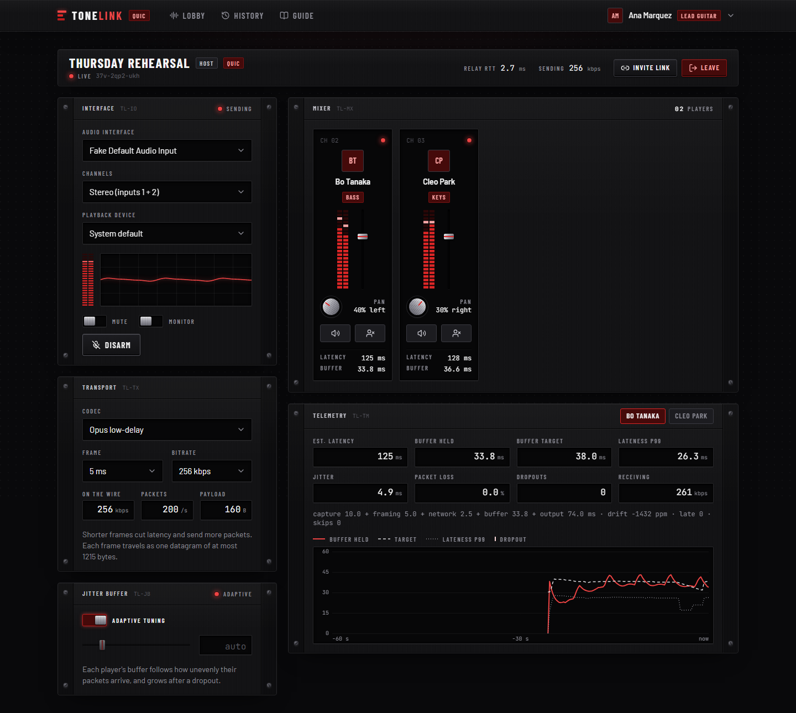
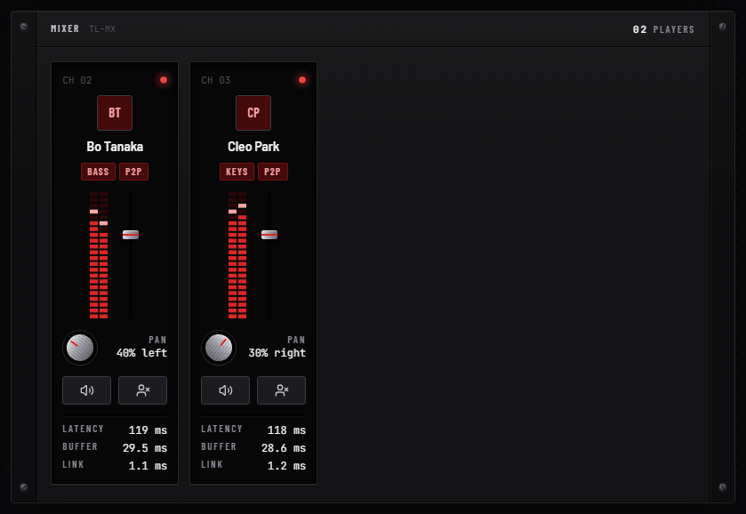
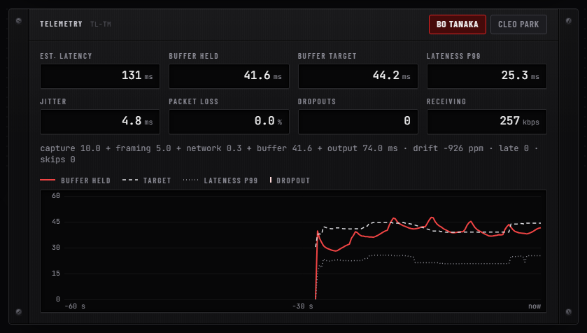
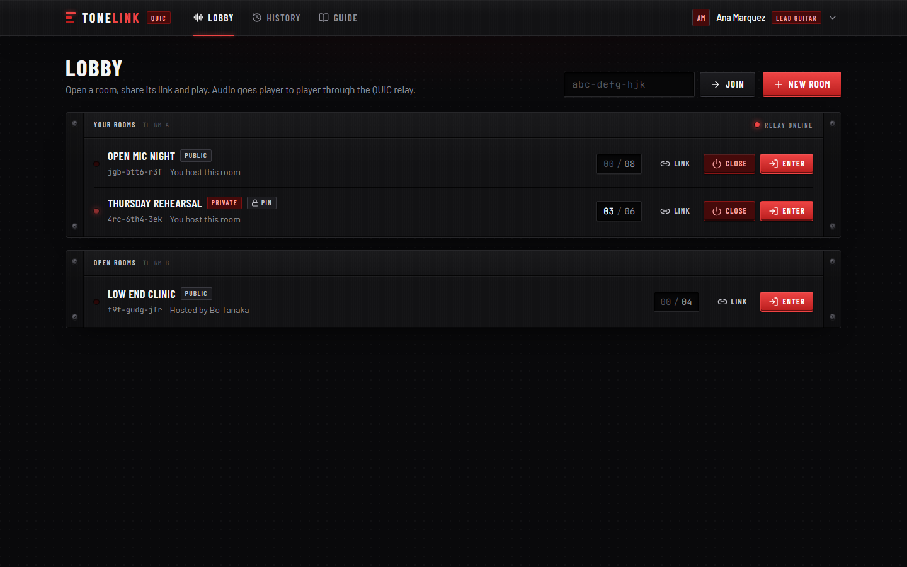
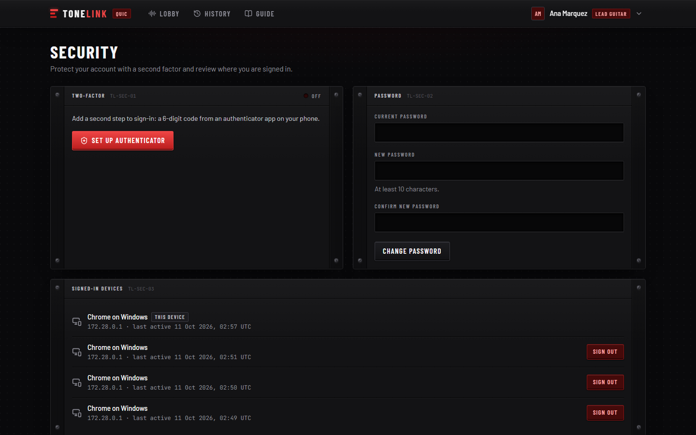
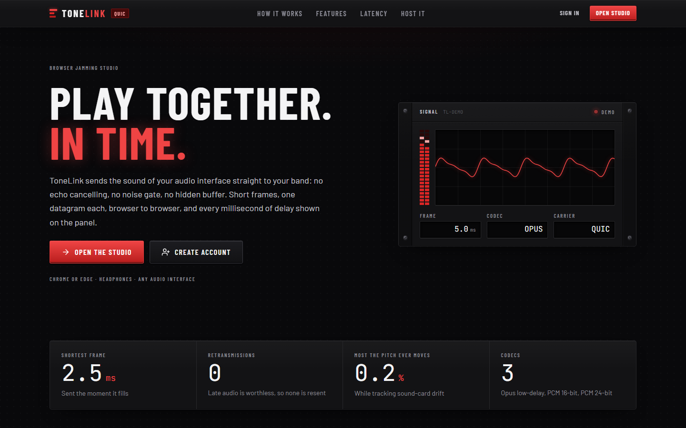
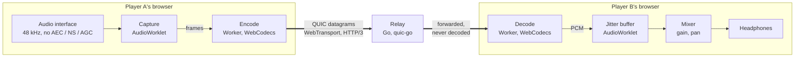
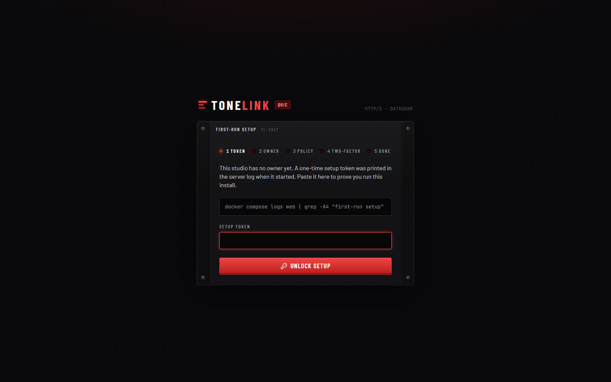

<p align="center">
  
</p>

<h1 align="center">ToneLink QUIC</h1>

<p align="center">
  <strong>Play music together from a browser, without the delay of a video call.</strong><br>
  Raw interface audio, encoded with WebCodecs, sent as QUIC datagrams over WebTransport.
</p>

<p align="center">
  
  
  
  
</p>

---

## Why this exists

Video-call audio is built for speech. It cancels echo, suppresses noise, levels
the volume and hides network trouble by holding audio back, often 60 to 150 ms
of it. Every one of those steps is wrong for an instrument, and that much delay
makes playing in time impossible.

ToneLink QUIC does not use WebRTC at all. It builds its own audio path from four
browser features and keeps each stage small and visible.

| | A video call (WebRTC) | ToneLink QUIC |
|---|---|---|
| Capture | Echo cancel, noise gate, auto gain | All three off: the interface as it is |
| Framing | 20 ms packets | 2.5, 5, 10 or 20 ms, your choice |
| Codec | Opus tuned for voice | Opus in low-delay mode, or uncompressed PCM |
| Transport | RTP with retransmission and pacing | One QUIC datagram per frame, never retransmitted |
| Jitter buffer | Hidden, conservative (NetEQ) | Yours: adaptive or fixed, shown on a live trace |
| Where it runs | Inside the browser's media stack | AudioWorklets and a worker you can read |

## What you get

<table>
  <tr>
    <td width="50%" valign="top">
      <br>
      <strong>A mixer per player.</strong> Every remote player gets a strip with an LED
      peak meter, volume fader, pan and mute. Your mix is yours alone and costs
      nothing on the network.
    </td>
    <td width="50%" valign="top">
      <br>
      <strong>Latency you can account for.</strong> An interface-to-ears estimate broken
      into capture, framing, network, buffer and output, with jitter, loss and
      dropouts, and a one-minute trace of the buffer against its target.
    </td>
  </tr>
  <tr>
    <td valign="top">
      <br>
      <strong>Rooms by link.</strong> Private or public, with an optional PIN and a
      player limit. The host can remove a player or close the room.
    </td>
    <td valign="top">
      <br>
      <strong>Private by default.</strong> Nothing is served without signing in.
      Two-factor sign-in, recovery codes, lockout, a devices list, and a first-run
      wizard gated by a token from the server log.
    </td>
  </tr>
</table>

- **Three codecs.** Opus low-delay at 96 to 510 kbps, 16-bit PCM (1536 kbps) and
  24-bit PCM (2304 kbps). Combinations that cannot fit one datagram are never
  offered.
- **Adaptive buffer tuning.** Each player's buffer is sized from the lateness that
  99% of their recent packets stayed under, grows after a dropout and eases back.
- **Drift correction.** Two sound cards never run at the same speed. The buffer
  follows by at most 0.2%, about 3.5 cents, and copies samples untouched when on
  target.
- **Channel routing.** Stereo, mono from input 1, mono from input 2, or a mono sum,
  for the guitar that only arrives on the left.
- **A guide inside the app**, with screenshots, covering setup, latency,
  security, self-hosting and troubleshooting.
- **A public home page** that explains the idea, with the studio itself behind
  sign-in.

<p align="center">
  
</p>

## How it works



Three threads share the work in each browser, joined by message ports. The page's
main thread draws the interface and is never in the audio path, so a re-render
cannot cause a glitch.

| Piece | Where | What it does |
|---|---|---|
| Capture worklet | Audio thread | Routes the two inputs, cuts frames, hands each to the worker |
| Transport worker | Worker | WebTransport session, encoder, one decoder and estimator per remote player |
| Playback worklet | Audio thread, one per player | The jitter buffer: target fill, drift correction, concealment |
| Relay | Go container | Admits ticket holders, stamps the sender on each packet, fans out. Speaks WebTransport and a WebSocket fallback |
| Web app | Next.js container | Accounts, rooms, and the signed tickets the relay trusts |

A room ticket is a 60-second signed token. The web app issues one only after
checking the session, the room and its PIN; the relay checks nothing but the
signature. The relay stamps every audio packet with the sender's seat itself, so
one player cannot send as another.

## Quick start

You need Docker and Node.js 20 or newer (for one helper script).

```bash
git clone https://github.com/kizzbonez/tonelink.git
cd tonelink
npm run env:init              # writes .env with random secrets
docker compose up -d --build
docker compose logs web       # shows the one-time setup token
```

Open <http://127.0.0.1:3410/setup>, paste the token, create the owner account and
pair an authenticator app. Then open a room, press **Arm input** and play.

<p align="center">
  
</p>

Use a current **Chrome or Edge** on a computer, and **headphones**.

## Playing with people elsewhere

Out of the box every port is bound to `127.0.0.1`. Two things have to be reachable
before someone on another network can join.

| Part | Route | How to expose it |
|---|---|---|
| Web app | HTTPS | Any reverse proxy or tunnel that terminates TLS, pointed at `http://127.0.0.1:3410` |
| Relay, direct | **QUIC over UDP** | A directly reachable UDP port: a forwarded port on your router, or a server with a public address |
| Relay, fallback | WebSocket over HTTPS | A tunnel or proxy pointed at `http://127.0.0.1:4434`, and `RELAY_WS_URL` set to its public `wss://` address |

Each browser tries the direct route first and falls back to WebSocket if it does
not answer within three seconds. Players on different routes can share a room,
and a badge beside the room name shows which one you are on.

> [!IMPORTANT]
> The two routes are not equal. QUIC datagrams go straight to the relay and are
> never retransmitted. The fallback is TCP and takes whatever detour the tunnel
> takes: a tunnel can serve the web app, but it cannot carry UDP. Measure the
> fallback with `node e2e/ws-probe.mjs` before relying on it. A 20 ms round trip
> is playable; one of several hundred milliseconds is for listening, not for
> playing in time. Run the relay close to the players: network delay is distance.

```ini
APP_URL=https://studio.example.com
ALLOWED_ORIGINS=http://127.0.0.1:3410
RELAY_PUBLIC_URL=https://relay.example.com:4433
RELAY_CERT_HOSTS=relay.example.com
RELAY_BIND=0.0.0.0
```

For the direct route, `relay.example.com` must resolve straight to the relay's
machine (not proxied), with UDP 4433 forwarded to it. The relay issues its own certificate and hands the
fingerprint to each browser with the room ticket, so no certificate authority is
involved.

## Configuration

Settings live in `.env`, created by `npm run env:init` and never overwritten.

| Variable | Default | Meaning |
|---|---|---|
| `APP_URL` | `http://127.0.0.1:3410` | Address people open. `https` here also turns on Secure cookies and HSTS |
| `ALLOWED_ORIGINS` | `http://localhost:3410` | Extra origins allowed to make changes and to reach the relay |
| `RELAY_PUBLIC_URL` | `https://127.0.0.1:4433` | Where browsers reach the relay |
| `RELAY_CERT_HOSTS` | `127.0.0.1,localhost` | Names on the relay's self-signed certificate |
| `RELAY_BIND` | `127.0.0.1` | Address the relay's UDP port is bound to |
| `RELAY_WS_URL` | empty | Public `wss://` address of the WebSocket fallback. Empty turns it off |
| `RELAY_WS_PORT` | `4434` | Host port of the fallback, bound to `127.0.0.1` |
| `WEB_PORT` / `RELAY_PORT` | `3410` / `4433` | Host ports |
| `AUTH_SECRET` | generated | Signs sessions, encrypts authenticator secrets |
| `RELAY_SHARED_SECRET` | generated | Signs room tickets; shared by web and relay |
| `SETUP_TOKEN` | empty | Fixes the first-run token instead of logging a random one |

## Tested, including the sound

`npm run e2e` starts two real Chromium instances, gives each a known pair of sine
tones as its microphone, and has them join a room through the relay. It then
asserts what each side actually hears.

```text
PASS  host hears guest (Opus 256k): left channel pitch   (891 Hz, want 880)
PASS  host hears guest (Opus 256k): right channel pitch  (1313 Hz, want 1320)
PASS  host hears guest (Opus 256k): no packet loss       (0%)
PASS  host hears guest (Opus 256k): no dropouts          (0 underruns)
PASS  host hears guest (Opus 256k): receive bitrate      (251 kbps, want about 256)
PASS  host hears guest (PCM 16-bit): receive bitrate     (1505 kbps, want about 1536)
PASS  pcm24: frame shortened to 2.5 ms                   (PCM24 at 2.5 ms)
PASS  host hears guest (Opus 256k): buffer follows its target
PASS  manual buffer: target pinned                       (target 20 ms, setting 20 ms)
PASS  mute: nothing received                             (0 kbps)
PASS  kick: guest is told why
```

Pitch is read to the nearest analyser bin, 47 Hz wide. The run also switches
codec, pins the buffer, mutes and removes a player through the console, checking
the audio after each step.

| Command | What it runs |
|---|---|
| `npm run check` | ESLint with size budgets, TypeScript, and the unit tests |
| `npm test` | Unit tests: wire format, PCM, jitter buffer, tuner, auth, schemas |
| `docker compose build relay` | Builds the relay and runs `go vet` and `go test` |
| `npm run e2e` | Two browsers, real audio, through the Docker stack, including a room with one player on each route |
| `node e2e/ws-probe.mjs` | Connects through the public fallback address and prints its round trip |
| `npm run shots` | Regenerates every screenshot in this README and the guide |

> [!NOTE]
> The automated runs use Chromium's fake audio devices on one machine. The
> latency a real band sees depends on each player's interface, driver and
> network, which is exactly what the telemetry rack is there to show.

## Security

- Every page, API route and static file sits behind sign-in. Only the home page,
  its pictures and the sign-in, registration and setup screens are public.
- Passwords are bcrypt hashes. Sessions are signed cookies that only name a row in
  the database, so sign-out and revocation take effect at once.
- TOTP second factor with replay protection, hashed recovery codes, lockout after
  five failures, rate limits and a signed-in devices list.
- State-changing requests must carry a trusted `Origin`. A content security policy
  is set on every response.
- Containers run read-only as non-root with all capabilities dropped. The database
  is on an internal network and publishes no port.
- `security/secsuite/targets.yml` defines the scan targets for the source tree,
  the running site and the built images.

## Project layout

```text
relay/                     Go QUIC relay: tickets, rooms, datagram fan-out
prisma/                    Schema and migrations
src/app/                   Routes only: pages compose features, API handlers are thin
src/features/
  auth/                    Accounts, sessions, two-factor, first-run setup
  rooms/                   Lobby, tickets, history
  profile/  admin/  docs/  Profile and audio defaults, studio policy, the guide
  landing/                 The public home page
  studio/
    engine/                The audio engine
      worklets/            Capture and playback AudioWorklets
      worker/              WebTransport, WebCodecs, per-player receivers
      client/              Web Audio graph, store, diagnostics
    components/            The console: racks, strips, telemetry
src/ui/                    Tokens, primitives and the rack-hardware components
e2e/                       Two-browser audio test and the screenshot run
```

Files stay under 200 lines and functions under 40 (60 for components). The limits
are lint errors, not guidelines.

## Limits worth knowing

- Chrome and Edge on desktop are the tested browsers. The engine needs
  WebTransport, WebCodecs audio and AudioWorklet.
- Every player sends to every other player through the relay, so bandwidth grows
  with the room. Rooms are capped at 8.
- Lost packets are concealed, not recovered. There is no forward error correction.
- The WebSocket fallback is TCP. It keeps players connected where UDP is blocked,
  with more delay and less steady timing than the direct route.
- The relay keeps rooms and bans in memory. Restarting it disconnects everyone.

## Changelog

See [CHANGELOG.md](CHANGELOG.md).
